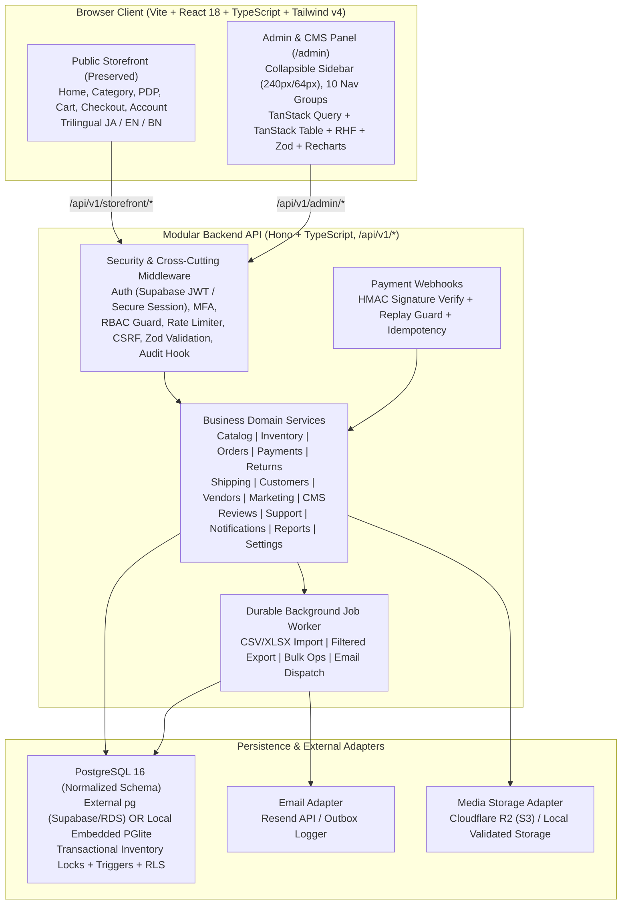

# Phase 1: System Architecture & Implementation Plan

**Project:** Beticrom E-Commerce Administration Panel & Storefront CMS  
**Architecture Style:** Modular Monolith (Vite React SPA + Layered TypeScript Hono API + Normalized PostgreSQL + Durable DB Job Queue)

---

## 1. High-Level System Architecture



---

## 2. Directory Structure Plan

All new code is cleanly segregated from the existing storefront to avoid regressions:

```text
beticrom/
├── docs/admin-cms/                  # Audit, Architecture, DB Design, API Docs, Deployment Checklist
├── supabase/
│   ├── migrations/                  # Versioned, non-destructive PostgreSQL migrations (0001..0006)
│   └── functions/server/            # Existing Deno stub preserved; shared Hono router compatible
├── server/                          # Modular Node/TypeScript API server (Hono)
│   ├── index.ts                     # HTTP entry point (port 3001, proxied by Vite /api -> :3001)
│   ├── app.ts                       # Hono app assembly (importable by tests without binding sockets)
│   ├── config/env.ts                # Zod-validated environment configuration
│   ├── db/
│   │   ├── client.ts                # Unified PostgreSQL interface (pg + PGlite auto-switch)
│   │   ├── migrate.ts               # Idempotent migration runner tracking schema_migrations
│   │   └── seed.ts                  # Catalog seeder (from products.json) + dev-only sample seed
│   ├── middleware/
│   │   ├── auth.ts                  # Session cookie / Supabase JWT authentication
│   │   ├── rbac.ts                  # Granular permission & vendor isolation enforcement
│   │   ├── rateLimit.ts             # Sliding-window rate limiter (login, webhooks, API)
│   │   ├── csrf.ts                  # Origin/CSRF token verification for cookie-mutating routes
│   │   ├── validate.ts              # Zod request validator + uniform error envelope
│   │   └── audit.ts                 # Structured audit log writer (redacts secrets/passwords)
│   ├── domains/
│   │   ├── auth/                    # Login, logout, session list/revoke, MFA TOTP, password reset
│   │   ├── rbac/                    # Admin users, roles, permissions, super-admin safeguard
│   │   ├── dashboard/               # Real-DB KPIs, trends, alerts, period comparisons
│   │   ├── catalog/                 # Products, variants, categories, brands, countries, attributes, import/export
│   │   ├── inventory/               # Stock levels, atomic reservations, movements, warehouses, suppliers, POs
│   │   ├── orders/                  # Explicit state machine, fulfillment, packing slips, invoices, notes
│   │   ├── payments/                # Methods, transactions, reconciliation, signed webhooks, refunds
│   │   ├── returns/                 # Return state machine, inspection, conditional restock, partial refunds
│   │   ├── shipping/                # Configurable geo hierarchy, zones, rates, pickup, couriers, shipments
│   │   ├── customers/               # Profiles, addresses, groups, notes, GDPR access/correct/delete
│   │   ├── vendors/                 # Optional multi-vendor registration, verification, commissions, payouts
│   │   ├── marketing/               # Offers, coupons, flash sales, campaigns, server-side checkout validator
│   │   ├── cms/                     # Homepage sections, sliders, banners, pages, menus, blog, announcements, team
│   │   ├── reviews/                 # Moderation workflow, merchant replies, verified purchase check
│   │   ├── support/                 # Contact messages, tickets, assignment, message threads
│   │   ├── notifications/           # Real event-driven admin notifications (read/unread, links)
│   │   ├── reports/                 # Reconciled financial, sales, inventory, tax, discount reports + CSV
│   │   ├── settings/                # Store, SEO, payment, email, integrations, maintenance, feature flags
│   │   ├── media/                   # MIME/size validated upload, metadata, library, R2/local adapter
│   │   └── storefront/              # Public read/checkout endpoints syncing storefront with live DB
│   ├── jobs/
│   │   ├── queue.ts                 # PostgreSQL durable job queue (FOR UPDATE SKIP LOCKED)
│   │   └── workers.ts               # Import, export, bulk edit, and notification workers
│   └── integrations/
│       ├── storage.ts               # Cloudflare R2 + LocalDisk adapter
│       ├── mailer.ts                # Resend + Outbox adapter
│       └── webhooks.ts              # HMAC-SHA256 verifier + replay protection
├── src/
│   ├── app/                         # Existing storefront (preserved + connected to live /api/v1/storefront)
│   ├── admin/                       # New production Admin & CMS application
│   │   ├── AdminApp.tsx             # QueryClientProvider, ThemeProvider, AuthProvider, Router
│   │   ├── api/client.ts            # Typed API client with CSRF, credentials, error normalization
│   │   ├── auth/                    # Login screen, MFA verify, Password recovery, PermissionGate
│   │   ├── layout/                  # AdminShell (240px/64px sidebar, mobile drawer, topbar, breadcrumbs, Cmd+K, notifications)
│   │   ├── components/              # DataTable (TanStack), KpiCard, StatusBadge, ConfirmDialog, Empty/Error/Skeleton states, MediaPicker
│   │   ├── config/navigation.ts     # All 10 groups & 62 routes with permission & feature-flag metadata
│   │   └── pages/                   # Feature pages organized by domain
│   └── lib/storefront-sync.ts       # Storefront data hook (loads live catalog/CMS/settings with seamless fallback)
└── tests/
    ├── unit/                        # State machines, tax/shipping/discount math, RBAC, webhooks
    ├── integration/                 # Full API + PostgreSQL tests (concurrency, vendor isolation, refunds)
    └── e2e/                         # Responsive UI & storefront CMS publishing tests
```

---

## 3. Security & Authorization Architecture

1. **Authentication:**
   - Passwords hashed with Node `crypto.scrypt` (unique 16-byte salt, timing-safe comparison) or delegated to Supabase Auth.
   - Sessions stored in `admin_sessions` with SHA-256 hashed opaque tokens in `HttpOnly; SameSite=Lax; Path=/` cookies (`Secure` when HTTPS).
   - Optional RFC 6238 TOTP MFA (`admin_mfa_factors`) with backup recovery codes.
   - Password recovery via time-limited single-use hashed tokens (`password_reset_tokens`).
2. **RBAC & Super-Admin Safeguard:**
   - Every `/api/v1/admin/*` route declares required permission(s) (e.g. `orders.update`, `refunds.create`).
   - Database trigger + service rule prevents deleting, deactivating, or revoking `super_admin` from the last active Super Admin account.
3. **Vendor Isolation:**
   - When a user has the `vendor` role (without global override permissions), middleware binds `ctx.vendorId` from `vendors.owner_user_id`. All queries on products, inventory, orders, and payouts enforce `WHERE vendor_id = $vendorId` both in SQL services and via PostgreSQL RLS policies.
4. **Input, Upload, CSRF, & Rate Limiting:**
   - All request payloads validated via Zod schemas; parameterized SQL queries exclusively (zero string interpolation).
   - File uploads validate magic bytes, MIME allowlist (`image/jpeg`, `image/png`, `image/webp`, `image/avif`, `video/mp4`, `application/pdf`, `text/csv`, `application/vnd.openxmlformats-officedocument.spreadsheetml.sheet`), and max file size.
   - Double-submit / `Origin` + `X-CSRF-Token` verification on cookie-authenticated mutations.
   - Rate limiting on `/auth/login`, `/auth/recover`, `/webhooks/*`, and public checkout/contact endpoints.
   - Audit log records actor, IP, user agent, action, entity, and sanitized before/after JSON diff (auto-redacting `password`, `token`, `secret`, `key`).

---

## 4. API Design Standards

- **Base Prefix:** `/api/v1`
  - `/api/v1/auth/*` — Admin & customer authentication, session, MFA, recovery
  - `/api/v1/admin/*` — Protected admin domain endpoints
  - `/api/v1/storefront/*` — Public storefront catalog, CMS, shipping calc, coupon verify, checkout, reviews, support
  - `/api/v1/webhooks/:provider` — Server-verified payment gateway webhooks
- **Standard Envelope:**
  - Success: `{ "data": ..., "meta": { "page": 1, "limit": 25, "total": 948, "totalPages": 38 } }`
  - Error: `{ "error": { "code": "VALIDATION_ERROR", "message": "...", "details": [...] } }`
- **Query Conventions:** `?page=1&limit=25&search=...&sort=created_at:desc&status=...&from=...&to=...`

---

## 5. Storefront Integration Strategy (Zero Regression)

To fulfill Section 29 ("The admin panel must be fully connected to the backend and storefront") without breaking existing behavior:
1. Introduce a lightweight `StorefrontDataProvider` that fetches `/api/v1/storefront/bootstrap` (active products, categories, published CMS sections/sliders/banners/announcements/menus/pages, store settings, active payment methods).
2. Existing storefront components (`Header`, `Homepage`, `CategoryPage`, `PDPPage`, `CartPage`, `CheckoutPage`, `Footer`) read live data from the provider (falling back gracefully to `ALL_PRODUCTS` only if the API is unreachable).
3. `CheckoutPage` submits real orders to `POST /api/v1/storefront/checkout`, validates coupons server-side (`POST /api/v1/storefront/coupons/validate`), calculates authoritative shipping & tax on the server, reserves inventory atomically in PostgreSQL, and creates real payment transactions & admin notifications!
4. Navigating to `/admin` or `#admin` opens the new production Admin Login -> Admin Panel (replacing the hardcoded passcode modal).

---

## 6. 9-Phase Implementation Roadmap

| Phase | Scope | Key Deliverables |
|---|---|---|
| **Phase 1** *(Current)* | Repository audit, architecture & database design | Audit doc, Architecture plan, DB design + ER diagrams, 6 non-destructive SQL migrations |
| **Phase 2** | Admin layout, authentication & permissions | Node/Hono server, PostgreSQL/PGlite runner, Auth + MFA + Sessions, RBAC + 8 roles + Super Admin lock, Admin shell (240px/64px sidebar, 10 groups, mobile drawer, dark/light theme, Cmd+K, breadcrumbs, notifications), Admin Users/Roles/Permissions/Audit Logs |
| **Phase 3** | Catalog, media & product management | Full Product CRUD + Variants + SEO + Duplication + Bulk ops, Categories/Subcategories (safe reassignment), Brands, Countries, Attributes, Media Library (validated uploads + R2/local), CSV/XLSX Import (mapping, preview, batch job, retry) & Filtered Export |
| **Phase 4** | Inventory, customers, orders & payments | Variant-level Inventory (physical/reserved/available/incoming/damaged), Atomic reservations & movements, Warehouses, Suppliers, Purchase Orders, Customer CRUD + Groups + GDPR tools, Order State Machine + Details + Storefront Checkout integration, Payment Methods + Transactions + Verified Webhooks |
| **Phase 5** | Shipping, returns, refunds & invoices | Configurable Geo Hierarchy (Country->Region->City->Area), Zones, Flat/Weight/Free-threshold Rates, Pickup, Couriers, Shipments & tracking, Return Workflow + Inspection + Conditional Restock, Partial/Full Refunds (balance-guarded), Printable Invoices & Packing Slips |
| **Phase 6** | CMS, promotions, reviews & support | Homepage Sections, Desktop/Mobile Sliders, Banners, Pages, Menus, Blog Categories/Posts, Team Members, Announcements (draft/published/scheduled + live storefront sync), Offers/Coupons/Flash Sales/Campaigns + server-side checkout engine, Review Moderation, Contact Messages & Support Tickets |
| **Phase 7** | Reports, analytics & notifications | Real-DB Dashboard KPIs (documented formulas, period comparisons, Recharts trends, alerts, quick actions), Analytics page, 11 reconciled Reports + CSV/Print, Event-driven Notification Center, Full Settings suite (Store/SEO/Payment/Email/Integrations/Maintenance/Feature Flags) |
| **Phase 8** | Optional vendor marketplace | Vendor registration, verification & approval workflow, Vendor store profiles, Vendor-scoped products/inventory/orders, Multi-vendor order splitting, Commission rules, Earnings & Payouts, Strict API + DB RLS vendor isolation |
| **Phase 9** | Security hardening, testing, optimization & deployment | Unit + Integration + E2E test suites (auth, RBAC, concurrency, webhooks, returns, refunds, vendor isolation, CMS publishing, responsive 360px), Security audit, Performance indexing, API docs, Setup & Deployment checklist |
