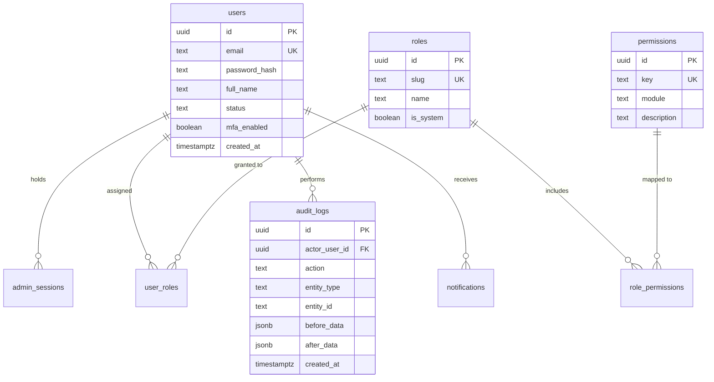
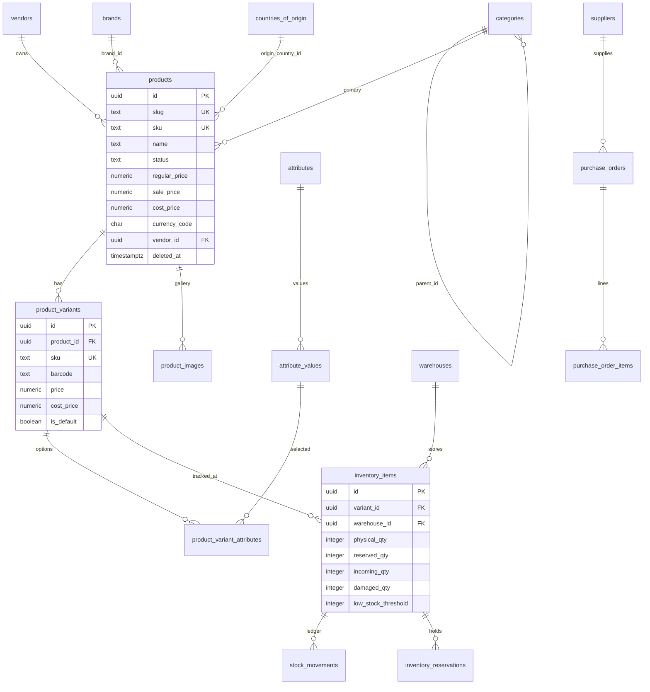
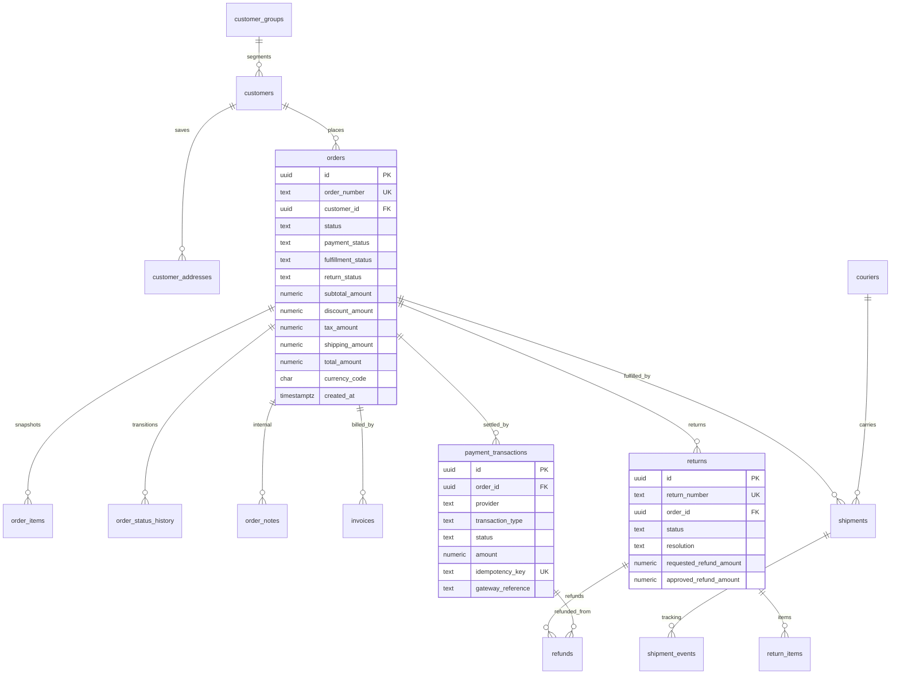
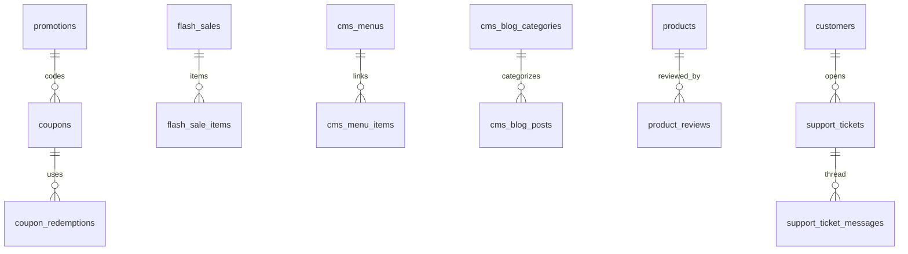

# Phase 1: Normalized PostgreSQL Database Design & Migration Plan

**Database Engine:** PostgreSQL 16+ (compatible with Supabase PostgreSQL & embedded local PGlite)  
**Migration Style:** Versioned, strictly additive (`CREATE TABLE IF NOT EXISTS`, `CREATE INDEX IF NOT EXISTS`, `ON CONFLICT DO NOTHING`) — zero destructive drops against existing production schemas.

---

## 1. Core Database Conventions

- **Primary Keys:** `UUID` (`gen_random_uuid()`) for all business entities.
- **Monetary Values:** `NUMERIC(14, 2)` paired with explicit `currency_code CHAR(3) NOT NULL DEFAULT 'JPY'` (exact decimal arithmetic, zero floating-point drift).
- **Timestamps:** `TIMESTAMPTZ NOT NULL DEFAULT NOW()` stored in UTC.
- **Soft Deletion:** `deleted_at TIMESTAMPTZ` on user-recoverable entities (`products`, `categories`, `customers`, `vendors`, `cms_pages`, `cms_blog_posts`, `coupons`); **never** soft-deleted/mutated on immutable financial & audit ledgers (`payment_transactions`, `refunds`, `stock_movements`, `audit_logs`, `order_status_history`).
- **Snapshots:** `order_items` stores immutable order-time snapshots (`product_name`, `sku`, `variant_title`, `unit_price`, `cost_price`, `tax_rate`, `tax_amount`, `discount_amount`, `line_total`, `image_url`, `storage_type`, `halal_tier`).
- **Concurrency Control:** Inventory reservation/deduction functions acquire row-level locks (`SELECT ... FROM inventory_items WHERE ... FOR UPDATE`) inside atomic database transactions to eliminate overselling under concurrent checkout load.

---

## 2. Entity-Relationship Diagrams

### 2.1 Auth, RBAC, Settings, Audit & Jobs

### 2.2 Catalog, Variants, Media, Inventory & Vendors

### 2.3 Orders, Payments, Shipping, Returns & Customers

### 2.4 Marketing, Storefront CMS, Reviews & Support

---

## 3. Domain Table Inventory (60 Tables across 6 Migrations)

| Migration File | Domain Coverage | Key Tables & Database Objects |
|---|---|---|
| `202611260001_core_auth_rbac_settings.sql` | Auth, RBAC, Audit, Settings, Jobs | `schema_migrations`, `users`, `admin_sessions`, `admin_mfa_factors`, `password_reset_tokens`, `roles`, `permissions`, `role_permissions`, `user_roles`, `audit_logs`, `store_settings`, `background_jobs`, trigger `prevent_last_super_admin_removal()` |
| `202611260002_catalog_media_vendors.sql` | Vendors, Taxonomy, Media, Products | `vendors`, `vendor_applications`, `vendor_payouts`, `categories`, `brands`, `countries_of_origin`, `tax_classes`, `shipping_classes`, `attributes`, `attribute_values`, `media_assets`, `products`, `product_images`, `product_variants`, `product_variant_attributes`, `product_import_jobs` |
| `202611260003_inventory_procurement.sql` | Multi-Warehouse Inventory & Procurement | `warehouses`, `suppliers`, `inventory_items`, `stock_movements`, `inventory_reservations`, `purchase_orders`, `purchase_order_items`, atomic PL/pgSQL functions (`reserve_inventory`, `release_inventory_reservation`, `deduct_fulfilled_inventory`, `restock_returned_inventory`) |
| `202611260004_customers_orders_payments_shipping_returns.sql` | Customers, Geo/Shipping, Orders, Payments, Returns | `customer_groups`, `customers`, `customer_addresses`, `shipping_countries`, `shipping_regions`, `shipping_cities`, `shipping_zones`, `shipping_zone_locations`, `shipping_rates`, `pickup_locations`, `couriers`, `orders`, `order_items`, `order_status_history`, `order_notes`, `invoices`, `payment_methods`, `payment_transactions`, `payment_webhooks`, `shipments`, `shipment_events`, `returns`, `return_items`, `refunds`, triggers `enforce_refund_balance_limit()` & `prevent_financial_ledger_mutation()` |
| `202611260005_marketing_cms_reviews_support_notifications.sql` | Promotions, CMS, Reviews, Support, Notifications | `promotions`, `coupons`, `coupon_redemptions`, `flash_sales`, `flash_sale_items`, `campaigns`, `cms_homepage_sections`, `cms_sliders`, `cms_banners`, `cms_pages`, `cms_menus`, `cms_menu_items`, `cms_blog_categories`, `cms_blog_posts`, `cms_announcements`, `team_members`, `product_reviews`, `contact_messages`, `support_tickets`, `support_ticket_messages`, `notifications`, `email_outbox` |
| `202611260006_rls_and_seed_defaults.sql` | RBAC Seed Matrix, Default Store Config, RLS | 8 default roles, 52 granular permissions, role-permission mappings, default store/tax/payment/shipping settings, Supabase RLS policies for vendor isolation |

---

## 4. Documented Financial & Dashboard Metric Formulas

Every KPI in the Dashboard and Financial Reports uses these exact SQL-level definitions:

- **Gross Sales** = `SUM(order_items.unit_price * order_items.quantity)` for orders where `status NOT IN ('cancelled', 'failed')` and `payment_status IN ('paid', 'partially_refunded', 'refunded')` (or confirmed COD/bank orders as configured).
- **Discounts** = `SUM(orders.discount_amount)` across the same order set.
- **Refunds** = `SUM(refunds.amount)` where `refunds.status = 'completed'` within the reporting period.
- **Net Sales** = `Gross Sales - Discounts - Refunds`.
- **Cost of Goods Sold (COGS)** = `SUM(order_items.cost_price * (order_items.quantity - COALESCE(returned_restocked_qty, 0)))`.
- **Gross Profit** = `Net Sales - COGS`.
- **Shipping Revenue** = `SUM(orders.shipping_amount)`.
- **Tax Collected** = `SUM(orders.tax_amount)` (broken down into `8%` reduced food rate and `10%` standard service rate for Japan, or configured tax classes for any country).
- **Available Stock** = `GREATEST(0, physical_qty - reserved_qty - damaged_qty)` (PostgreSQL generated column `available_qty`).
- **Period Comparison Delta (%)** = `CASE WHEN prev_value = 0 THEN NULL ELSE ROUND(((curr_value - prev_value) / prev_value) * 100, 2) END` — displays `"N/A"` when the prior period has zero baseline rather than fabricating growth percentages.

---

## 5. Non-Destructive Migration & Backup/Restore Strategy

1. **Zero Destructive DDL:** Migrations never drop existing tables (including any legacy `kv_store` table in Supabase) or truncate existing production rows.
2. **Idempotent Runner:** `server/db/migrate.ts` tracks checksums in `schema_migrations` and executes each `.sql` migration inside a transaction.
3. **Backup & Restore Procedure:**
   - **External PostgreSQL / Supabase:** `pg_dump --format=custom --no-owner --file=backup_YYYYMMDD.dump "$DATABASE_URL"` and `pg_restore --clean --if-exists --no-owner --dbname="$DATABASE_URL" backup_YYYYMMDD.dump`.
   - **Local Embedded PGlite:** Snapshot `.local/pgdata/` directory (cold copy after server stop) or export logical SQL dump via admin CLI `npm run db:backup`.
