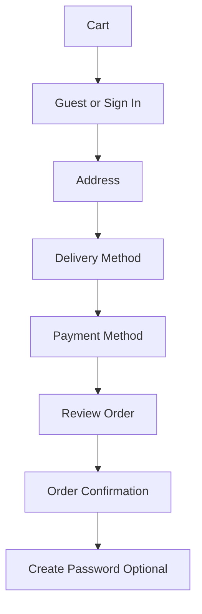
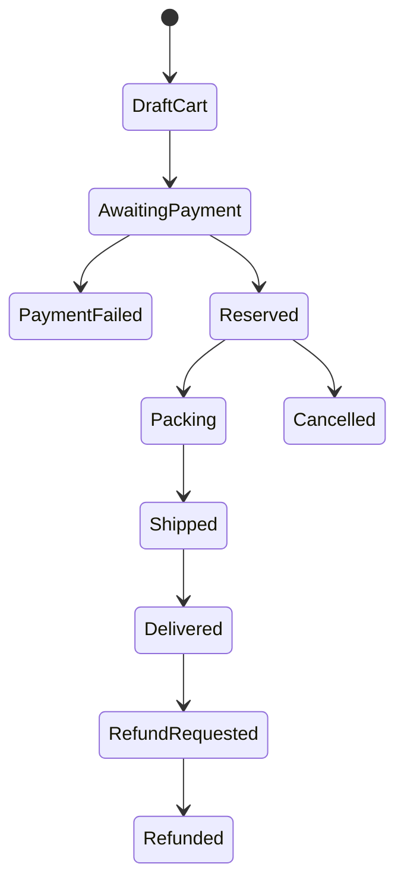
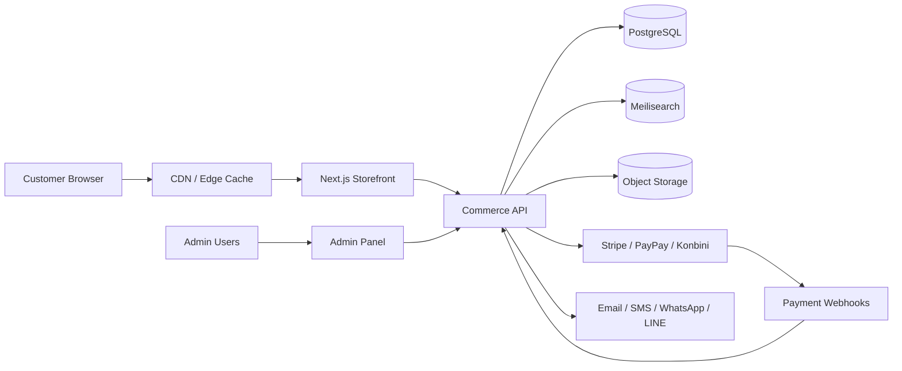

# Designing and Architecting a Long-Lived Halal Grocery Ecommerce Site for Japan

## Executive Summary

A high-quality halal grocery ecommerce site for Japan should not be designed as a generic supermarket, and it should not be a literal copy of SHEIN. The right goal is a **mobile-first, trust-led, promotion-aware grocery storefront** that borrows SHEIN’s visual energy, content density, and merchandising rhythm, while replacing fashion-centric clutter with grocery clarity, halal credibility, and repeat-order convenience. SHEIN’s current Japanese homepage emphasizes a strong promo bar, dense category access, image-heavy merchandising, flash-sale zones, and tag-driven discovery; those patterns are useful, but Baymard’s ecommerce research also shows that mobile UX, product-page clarity, account/self-service, and checkout execution are still major weak points across ecommerce, so the adaptation has to be disciplined rather than maximalist. citeturn1view0turn2search8turn2search4turn2search0turn17search2

For this market, the site should be built around three user groups: **Muslim residents in Japan who need dependable halal trust signals and practical delivery**, **South Asian and other expat households who need culturally familiar groceries plus reorder speed**, and **Japanese halal-curious shoppers who need education, ingredient transparency, and low-friction entry points**. Japan does not have a single specialized national halal accreditation agency, and public tourism guidance in Japan points users to certifiers such as the Japan Muslim Association and Halal Japan Business Association; that means the site should show **source-level proof**, not vague “halal-friendly” marketing alone. citeturn9search7turn10view0

The strongest overall implementation choice is a **headless architecture with Next.js on the storefront and Medusa as the commerce backend**, extended with custom modules for dry/cool/frozen shipping rules, reservation logic, Japanese payment flows, halal metadata, and multilingual content. Next.js gives strong deployment flexibility, modern data-fetching patterns, image optimization, and Web Vitals instrumentation, while Medusa is explicitly designed as a separately hosted commerce server with a separate storefront and customizable admin. For this business profile, that creates a better balance of control, speed, and long-term adaptability than a fully custom build or Shopify headless. citeturn6search3turn0search7turn0search4turn15search0turn0search20turn0search2turn0search5turn0search8turn8search5

The design target for the next three years should be: **no major redesign, only iterative optimization**. That means locking in a robust design system, a modular component library, operationally correct shipping and inventory logic, structured product data for Google, clean instrumentation for GA4, and an admin panel that supports merchandising, fulfillment, finance reconciliation, and customer support from day one. Google’s product structured data and merchant listing guidance, Merchant Center product data requirements, and GA4 ecommerce events make this architecture especially valuable for organic growth and measurable conversion improvement. citeturn4search2turn4search5turn5search1turn5search0turn11search1turn11search0

## Market and Audience Model

The site should be positioned as **Japan’s trusted halal grocery and daily essentials store**, not only as an “international grocery.” That positioning matters because the purchase decision is not just about price and assortment; it is also about religious compliance, ingredient trust, delivery integrity, and household routine. Public Japanese tourism guidance explicitly notes that halal resources in Japan are still important and that halal-certified products and compliant restaurants have expanded, but that trust remains mediated by recognizable organizations and practical guidance rather than a single state-backed standard. citeturn9search7turn10view0

The primary audience is best understood as three overlapping jobs-to-be-done:

| User group | Core need | Key site behavior | What wins conversion |
|---|---|---|---|
| Muslim residents in Japan | Shariah-compliant food they can trust | Search by halal status, supplier, storage type, delivery timing | Clear halal proof, ingredient transparency, reliable cold-chain policies |
| South Asian and other expat households | Familiar pantry, fresh items, repeat staples | Browse by cuisine/country, reorder previous baskets, shop on mobile | Fast search, large-pack units, language support, reorder flow |
| Japanese halal-curious shoppers | Safe trial purchase with easy comprehension | Browse curated pages, educational PDPs, lighter baskets | Japanese copywriting, transliterated search, beginner bundles, strong trust UI |

This segmentation implies that the site should support **mission-based shopping** as much as category shopping. Baymard’s navigation and search research consistently emphasizes that users combine search and browsing, and that product-finding UX depends on giving users multiple intuitive routes into the catalog. For this business, those routes should include **Shop by Category**, **Shop by Cuisine/Country**, **Halal Verified**, **Weekly Deals**, **New in Japan**, and **Reorder Past Basket**. citeturn2search17turn17search14turn2search13

A SHEIN-inspired visual system is appropriate only at the level of **merchandising tempo**. The current SHEIN Japan homepage foregrounds the sale code bar, wide category exposure, many image-led tiles, “Flash Sale,” “Super Deals,” and tag-led trend discovery. For a grocery store, those patterns should be translated into **Today’s Deals**, **Ramadan / Eid campaigns**, **Fresh Restock**, **Halal Meat Drops**, **Shop by Country**, **New Customer Bundle**, and **Household Essentials**. The right adaptation is “high-velocity merchandising with operational clarity,” not endless banner density. Baymard also cautions against auto-rotating carousels and weak category structures on mobile, so the grocery site should use static or manually swipeable zones, not distracting motion-heavy hero areas. citeturn1view0turn2search2turn2search8

Because Japan has no single specialized halal accreditation agency, the trust model should be tiered. At minimum, badges should distinguish: **Certified Halal**, **Supplier-Declared Halal**, **No Pork / No Alcohol Ingredients**, and **Muslim-Friendly**. For products with third-party verification, the PDP should show the certifier name and evidence source; JNTO specifically points to the Japan Muslim Association and Halal Japan Business Association as recognizable certification/approval references in Japan. This is more durable and defensible than a binary “halal / not halal” system. citeturn9search7turn10view0

## Experience Architecture and Design System

The design language should take SHEIN’s strengths—**bold merchandising, dense visual rhythm, deal visibility, quick scanning**—and combine them with grocery-specific discipline: **strong legibility, predictable hierarchy, fewer gimmicks, and more operational information above the fold**. Baymard’s benchmarks show that mobile ecommerce, product pages, and checkout still fail users frequently, so the design system should optimize for **repeatable decisions**, not purely visual novelty. citeturn1view0turn2search8turn17search11turn2search0

A durable three-year design system for this category should use the following token philosophy:

| Layer | Recommendation | Why it works long-term |
|---|---|---|
| Brand colors | Deep forest green, warm red, neutral off-white, charcoal text, soft gold accent | Green supports halal/trust; red supports promo urgency; neutrals prevent visual fatigue |
| Typography | Japanese-first sans for JA, paired with high-legibility Latin/Bengali support | Reduces mismatch across JA/EN/BN and keeps product data readable |
| Spacing | 4/8/12/16/24/32/48 px scale | Easy for design/dev consistency and future expansion |
| Borders | Light 1 px borders, medium rounding, elevated promo cards only where needed | Keeps UI modern without over-styling |
| Iconography | Simple outline icons with filled state for cart, wishlist, halal, frozen, low stock | Reduces cognitive load on mobile |
| Motion | Micro-transitions only; no autoplay hero slider | Better for usability and long-term maintainability |

The color strategy should not imitate SHEIN’s black-and-white fashion identity directly. Grocery requires more semantic color. Red can still signal urgency and savings, but **green must mean trust/compliance**, blue can mean frozen/cool-chain information, and amber can mean low stock or order cutoff. That kind of semantic stability reduces future redesign pressure because meaning stays consistent even when campaigns change. This is also aligned with Google’s broader emphasis on good page experience and clear content understanding. citeturn15search5turn15search2

The component library should be designed as a **strict design system**, not page-by-page custom art direction. That is what prevents a major redesign for roughly three years.

### UI component inventory

| Component | Variants | Must-have behavior |
|---|---|---|
| Announcement bar | delivery, coupon, seasonal | sticky on mobile, dismissible, campaign schedulable |
| Header | compact, search-active, checkout | persistent search, cart count, locale switch, account shortcut |
| Category tile | square, horizontal, icon-led | large tap targets, supports image + translated label |
| Product card | grid, list, compact-cart | image, price, old price, halal badge, storage badge, quick add |
| Promo card | hero, mid-page, small tile | one message, one CTA, optional countdown |
| Filter drawer | category, brand, dietary, price, delivery type | sticky apply/reset, preserves state in URL |
| Search suggestions | popular, recent, category jump, synonym hits | typo-tolerant and multilingual |
| PDP info block | price, badges, description, delivery note | sticky add-to-cart on mobile |
| Quantity control | inline, large-tap | button-based first, editable second |
| Cart drawer | light edit, threshold progress | quantity buttons, remove, save for later |
| Checkout stepper | address, delivery, payment, review | persistent summary and state recovery |
| Trust badge strip | halal, delivery, refund, support | links to proof pages |
| Account modules | orders, addresses, payment methods, support | clear self-service entry points |
| Admin data table | order, inventory, catalog | bulk actions, saved filters, CSV export |

Baymard’s checkout guidance specifically recommends button-based quantity changes, prominent guest checkout, and well-structured account/self-service flows. That means the component library cannot treat cart/account components as second-class UI; they need the same rigor as homepage and PDP components. citeturn17search9turn17search0turn17search2

The multilingual design system should be architected as **JA-first, EN-second, BN-third**, with extensibility for Hindi, Urdu, Nepali, or Indonesian later. Product entities should support locale-specific fields rather than relying on runtime machine translation. Meilisearch supports localized attributes and language-specific tokenization, including Bangla and Japanese, which is especially useful for mixed-language grocery catalogs and transliterated terms. citeturn16search0turn16search9turn16search4

The following wireframes show the recommended information hierarchy. They are intentionally simple so they can survive multiple merchandising cycles without a redesign.

### Sample mobile homepage wireframe

```text
┌─────────────────────────────────────┐
│ Promo bar: Free dry shipping ¥6,500│
├─────────────────────────────────────┤
│ Logo   Search...             Cart  │
│ JA | EN | BN                       │
├─────────────────────────────────────┤
│ [Hero banner: Halal Summer Deals]  │
│ [Shop Now] [View Halal Meat]       │
├─────────────────────────────────────┤
│ Quick categories                    │
│ [Meat][Rice][Spices][Frozen]       │
│ [Snacks][Drinks][Baby][Beauty]     │
├─────────────────────────────────────┤
│ Shop by country                     │
│ [Bangladesh][India][Pakistan]      │
│ [Japan][Myanmar][Nepal]            │
├─────────────────────────────────────┤
│ Today’s Deals                       │
│ [Product Card][Product Card]       │
│ [Product Card][Product Card]       │
├─────────────────────────────────────┤
│ Trust strip                         │
│ Halal proof | Cold-chain | Refunds │
├─────────────────────────────────────┤
│ Reorder essentials                  │
│ Recently bought / Most reordered    │
└─────────────────────────────────────┘
```

### Sample mobile PDP wireframe

```text
┌─────────────────────────────────────┐
│ Back                     Wishlist   │
├─────────────────────────────────────┤
│ [Product gallery]                   │
├─────────────────────────────────────┤
│ Chicken Samosa 20pcs                │
│ ¥780   ¥980                         │
│ [Certified Halal] [Frozen] [In stock]│
│ Supplier: XYZ Foods                 │
│ Origin: Japan                       │
├─────────────────────────────────────┤
│ Short description                   │
│ Ingredients / allergens / storage   │
│ Delivery: Frozen shipping required  │
│ Returns: quality issue within 24h   │
├─────────────────────────────────────┤
│ Often bought together               │
│ [Sauce] [Paratha] [Tea]             │
├─────────────────────────────────────┤
│ Qty [-] [1] [+]     [Add to Cart]   │
└─────────────────────────────────────┘
```

Those hierarchies follow Baymard’s emphasis on discoverability, adequate product information, and checkout readiness, while still leaving room for SHEIN-like deal energy in the top half of the experience. citeturn17search11turn2search17turn1view0

## Customer Journeys, Sitemap, and Merchandising Flows

The storefront should be designed around **six high-intent journeys**: discovery, category browse, product evaluation, cart building, checkout, and reorder/self-service. Baymard’s research on homepage/category navigation, product pages, checkout, and accounts suggests that each of these surfaces carries frequent ecommerce failure modes, so they should be treated as separate product surfaces with explicit goals and metrics. citeturn2search17turn17search11turn17search9turn17search2

### Recommended sitemap

| Area | Pages |
|---|---|
| Core storefront | Home, Shop All, Deals, New Arrivals, Best Sellers |
| Discovery | Search, Shop by Category, Shop by Country/Cuisine, Halal Verified, Beginner Kits |
| Category level | Meat, Rice & Flour, Spices, Frozen Food, Dairy, Snacks, Drinks, Fresh Produce, Baby Care, Beauty & Health |
| Product level | PDP, Variant pages where necessary, bundle pages |
| Conversion | Cart, Checkout, Order Confirmation, Track Order |
| Account | Sign in, Register, Orders, Saved Addresses, Saved Cards, Wishlist, Reorder, Support Tickets |
| Trust & content | About, Delivery Policy, Refund Policy, Halal Standards, FAQs, Contact |
| Growth content | Recipes, Guides, Ramadan/Eid pages, “How to shop halal in Japan” |
| Store operations | Pickup page, local delivery info, service-area pages if applicable |

The homepage should do four jobs at once: establish credibility, help users orient themselves, promote current campaigns, and expose fast paths into the catalog. SHEIN’s category density proves the value of visible entry points, but Baymard’s mobile research warns against shallow or confusing taxonomy and overreliance on rotating banners. In practice, the homepage should have **one hero**, **one quick category grid**, **one country/cuisine strip**, **one deals module**, **one reorder/personalized module for signed-in users**, and **one trust module**. citeturn1view0turn2search2turn2search8

The category page is where grocery users win or lose time. It should support both **scroll-and-scan browsing** and **rapid refinement**. Baymard’s product lists and search research strongly favors robust filters and product-finding routes. For this business, the most valuable filters are **halal level**, **delivery type**, **brand**, **country**, **package size**, **price**, **in stock**, and **discounted**. Product cards should expose pack size, price, crossed-out price where relevant, and a quick-add control; they should not require a PDP visit for routine staple purchases. citeturn2search12turn17search14

The PDP should be treated as both a sales page and a compliance page. Baymard’s product-page benchmark shows that many ecommerce product pages still perform poorly, especially on mobile. For halal grocery, that is even riskier because users need to evaluate ingredients, storage method, shelf life, origin, and certification. Every PDP should therefore show **product name, pack size, halal evidence tier, ingredients, allergens, storage directions, delivery mode, delivery restrictions, refund window, and supplier/brand** above the fold or within one scroll depth. citeturn17search11turn2search4

The cart should be a *decision support interface*, not just a list of items. Baymard’s checkout research highlights quantity controls, fulfillment option clarity, and friction reduction. A halal grocery cart should therefore show: **shipping-threshold progress**, **delivery-mode grouping** if the basket mixes dry/cool/frozen goods, **estimated earliest delivery date**, **quantity buttons**, **low-stock warnings**, and **save for later**. Mixed-temperature baskets should never surprise users at the payment step. citeturn17search9turn2search0

The checkout flow should be concise and forgiving. Baymard recommends prominent guest checkout, simpler form flows, and payment fields that validate inline. Stripe supports hosted and embedded payment UIs, and its PayPay documentation notes that it can automatically determine and show relevant payment methods in supported flows, which is useful for reducing decision overload in Japan. For card entry, Baymard specifically recommends auto-formatting spaces in the credit card field and validating early. citeturn17search0turn17search9turn17search1turn17search3turn3search0

A best-practice checkout flow for this site is:



Delayed account creation is preferable for first-time users: Baymard explicitly recommends saving account creation for after the order is complete, and making guest checkout highly visible. That is especially appropriate for grocery, where urgency and convenience outweigh loyalty-program onboarding in the first transaction. citeturn17search12turn17search0turn17search6

The account area should not be minimal. Baymard’s account/self-service research shows that this area is often underbuilt, even though it has an outsized effect on repeat business. For a grocery site, account surfaces should prominently include **Orders**, **Track Order**, **Reorder**, **Saved Baskets**, **Addresses**, **Payment Methods**, **Refund Requests**, and **Support**. Reorder should be a primary module, not a buried feature. citeturn17search2turn17search5

## Commerce Logic, Trust Signals, and Operational Admin

The operational model has to be correct from the start because grocery creates more failure modes than fashion: temperature sensitivity, expiration risk, substitutions, and partial fulfillment all matter. The shipping model should classify items into **dry**, **cool**, and **frozen** delivery, and the cart/pricing engine should decide whether the order can ship as one parcel, as split shipments, or not at all. Google’s merchant listing markup explicitly supports shipping details and return-policy information, which is another reason to model this deeply in the catalog and checkout data model rather than handling it as static text alone. citeturn4search2turn4search5

A practical delivery matrix looks like this:

| Delivery mode | Typical products | Operational rules |
|---|---|---|
| Dry | rice, flour, spices, canned goods, snacks | standard shipping SLA, room-temp warehouse |
| Cool | dairy, selected produce, fresh items | insulated shipping, delivery-date selection if feasible |
| Frozen | meat, paratha, frozen snacks | cold-chain packaging, stricter cutoffs, no ambient mix unless split |
| Pickup | local customers | inventory reserved at store, pickup window enforced |

The reservation and inventory rules should be explicit. Inventory should move through **available → reserved → packed → shipped → delivered**, with release conditions for failed payments and cancellations. For PaymentIntent-style flows and delayed methods like Konbini, stock should be reserved for a defined SLA window rather than decremented permanently before payment clears. Stripe’s Konbini documentation notes that this is a single-use cash method completed later at a convenience store, with Stripe notifying you when the payment finishes; that makes reservation windows mandatory. citeturn3search1turn3search4

A clean order state model is:



Payment methods for Japan should be layered by operational value, not only by popularity. Stripe’s Japan-focused payment resources note that ecommerce in Japan commonly uses credit cards and Konbini, and Stripe provides dedicated support documentation for PayPay and Konbini. PayPay is a Japan-only wallet method in JPY and is not for subscriptions; Konbini lets customers complete purchases with codes at convenience stores; both can reduce abandonment among users who do not want to use cards. Bank transfer and COD can be offered as operationally controlled offline methods, but they should be gated by risk rules and customer location/order history. citeturn3search2turn3search0turn3search9turn3search1turn3search4

A recommended payment mix is:

| Method | Customer value | Operational note |
|---|---|---|
| Card via Stripe | fastest universal method | default online option |
| PayPay | very strong Japan mobile option | good for mobile conversion; JPY only |
| Konbini | cash-friendly and cardless | reserve inventory until payment cutoff |
| Bank transfer | useful for some households and B2B-ish bulk buyers | require manual reconciliation |
| COD optional | useful in trust-building phase | use selectively; monitor refusal/loss rates |

Search should be built as a first-class growth surface, not a utility feature. Baymard’s search research emphasizes how central search is to ecommerce product finding, and Meilisearch offers built-in typo tolerance, synonyms, faceting, tokenization, and localized attributes that support Japanese and Bangla alongside English. Algolia is also strong, but its own support guidance notes caveats for languages without spaces and requires careful language configuration for Japanese. Given this catalog’s mix of JA/EN/BN and transliterated grocery terms, Meilisearch is the better default recommendation unless merchandising rules personalization becomes sophisticated enough to justify Algolia cost and tuning overhead. citeturn17search14turn4search0turn4search3turn4search21turn16search0turn16search9turn16search19turn16search5

The search UX should support the following behaviors:

| Search behavior | Example |
|---|---|
| Typo tolerance | “chickne” → chicken |
| Transliteration | “basmati”, “বাসমতি”, “バスマティ” |
| Synonyms | atta ↔ flour, ghee ↔ clarified butter |
| Locale-aware indexing | Japanese and Bangla product attributes indexed correctly |
| Prefix matching | “bir” → biryani, birista |
| Facet refinement | halal + frozen + in stock |
| Query suggestions | high-volume basket staples and brand names |

Trust signals should be distributed across the entire funnel. The site should not relegate them to a footer. Product cards should show halal/storage badges; PDPs should show evidence/source; cart should show fulfillment clarity; checkout should show payment and refund reassurance; account should show order and refund transparency. On the policy side, Google merchant listing guidance and Merchant Center data specs make it especially valuable to keep shipping and return policies both human-readable and machine-readable. citeturn4search5turn5search1turn5search17

The admin panel should be treated as another product, not a development afterthought. Medusa’s admin is designed for management of products, orders, customers, and more, and it is customizable through widgets and UI routes. That extensibility is useful because a halal grocery operator needs custom admin fields that standard fashion/admin tools do not include: halal evidence, storage type, expiry thresholds, cutoff windows, split-shipment rules, supplier metadata, and claim handling. citeturn0search2turn0search5turn0search8

At minimum, the operational admin should include these modules:

| Admin domain | Core capabilities |
|---|---|
| Catalog | products, variants, bundles, images, ingredients, allergens, halal evidence, country/cuisine mapping |
| Inventory | stock by SKU, reservation, incoming stock, expiry flags, damaged stock, frozen/cool location |
| Orders | payment status, fulfillment splitting, packing slips, refunds, substitutions, exception handling |
| Customers | profile, order history, fraud flags, support notes, saved baskets |
| Merchandising | homepage slots, banners, deal rules, sort boosts, campaign schedules |
| Content | policies, FAQs, multilingual CMS blocks, recipe pages |
| Finance | payment reconciliation, bank-transfer matching, COD reconciliation, tax/export reports |
| Support | tickets, return claims, photo uploads, SLA tracking |
| Roles & audit | RBAC, action logs, admin approvals, export permissions |

## Technical Architecture, Data Model, and Implementation Choices

The recommended reference architecture is **Next.js storefront + Medusa backend + PostgreSQL + object storage + search engine + Stripe payments + admin extensions**, deployed in a Japan-near region with CDN fronting. Next.js can be deployed as a Node.js server, Docker container, static export, or with adapters depending on infrastructure; its image tooling supports automatic sizing, modern formats such as WebP, lazy loading, and layout-stability safeguards; its Web Vitals tools support production measurement of TTFB, FCP, LCP, CLS, and INP. Medusa is designed around a separate commerce server and admin dashboard, with the storefront hosted separately, which fits a long-lived headless architecture well. citeturn6search3turn6search0turn0search4turn0search1turn15search0turn15search6turn0search20turn8search5

### Recommended architecture diagram



For the backend style, a modular TypeScript backend is preferable. Nest is explicitly positioned as a framework for efficient, scalable Node.js server-side applications and organizes systems around modules, controllers, and providers. Even if Medusa is chosen, custom modules and service boundaries should follow the same discipline: catalog, checkout, fulfillment, notifications, finance, and search indexing should be separable. citeturn14search1turn14search4turn14search2turn14search6

### Recommended tech stack

| Layer | Recommended choice | Rationale |
|---|---|---|
| Frontend | Next.js + TypeScript + Tailwind + design tokens | mobile-first performance, strong DX, reusable UI system |
| Commerce backend | Medusa headless with custom modules | faster than fully custom; still flexible for grocery logic |
| Database | PostgreSQL | relational integrity for orders, inventory, and payments |
| Search | Meilisearch | better multilingual fit for JA/EN/BN grocery catalogs |
| Storage | Cloudflare R2 | object storage without egress fees |
| CDN/WAF | Cloudflare | performance and security edge layer |
| Payments | Stripe + PayPay + Konbini; offline bank transfer/COD rules | Japanese payment coverage with operational flexibility |
| Observability | Vercel Observability for web + OpenTelemetry-based backend tracing | frontend + distributed backend visibility |
| CI/CD | GitHub Actions | predictable CI/CD with environment controls |
| Analytics | GA4 + Meta + Merchant Center + Search Console | conversion measurement and acquisition support |

Cloudflare R2 is explicitly positioned as scalable object storage without egress fees, and Neon’s production guidance recommends using paid plans for production and choosing a region close to the application to minimize latency; even if you do not use Neon specifically, those production principles are correct for a Japan-focused store. GitHub Actions provides CI/CD workflows and environment-based deployment controls, which is useful for separate preview, staging, and production pipelines. OpenTelemetry provides a vendor-neutral framework for traces, metrics, and logs in distributed systems. citeturn12search14turn12search4turn12search13turn13search0turn13search7turn13search11turn18search3turn18search1

### Core database schema

The data model should separate **catalog truth**, **operational truth**, and **presentation truth**. A practical schema is below.

| Table | Key fields |
|---|---|
| `products` | `id`, `slug`, `status`, `brand_id`, `primary_category_id`, `country_id`, `halal_tier`, `storage_type`, `default_locale`, `seo_title`, `seo_description`, `created_at`, `updated_at` |
| `product_localizations` | `product_id`, `locale`, `name`, `short_description`, `long_description`, `ingredients`, `usage_notes`, `search_keywords` |
| `product_variants` | `id`, `product_id`, `sku`, `barcode`, `weight_value`, `weight_unit`, `pack_size`, `price`, `compare_at_price`, `cost_price`, `tax_class`, `is_active` |
| `product_media` | `id`, `product_id`, `variant_id`, `url`, `alt_text`, `sort_order`, `kind` |
| `categories` | `id`, `parent_id`, `slug`, `sort_order` |
| `category_localizations` | `category_id`, `locale`, `name`, `description` |
| `brands` | `id`, `name`, `slug`, `origin_country` |
| `halal_evidence` | `id`, `product_id`, `evidence_type`, `certifier_name`, `certificate_number`, `issued_at`, `expires_at`, `document_url`, `verified_by_admin_id` |
| `inventory_items` | `variant_id`, `warehouse_id`, `on_hand`, `reserved`, `available`, `expiry_date_rule`, `lot_tracking` |
| `stock_movements` | `id`, `variant_id`, `movement_type`, `quantity`, `reason`, `reference_id`, `created_at` |
| `carts` | `id`, `customer_id`, `currency`, `locale`, `status`, `expires_at` |
| `cart_items` | `cart_id`, `variant_id`, `quantity`, `unit_price`, `delivery_mode_snapshot` |
| `orders` | `id`, `order_number`, `customer_id`, `status`, `payment_status`, `currency`, `subtotal`, `discount_total`, `shipping_total`, `tax_total`, `grand_total`, `locale`, `channel`, `placed_at` |
| `order_items` | `order_id`, `variant_id`, `product_name_snapshot`, `price_snapshot`, `quantity`, `halal_tier_snapshot`, `delivery_mode_snapshot` |
| `shipments` | `id`, `order_id`, `shipment_type`, `carrier`, `tracking_number`, `status`, `dispatch_at`, `delivered_at` |
| `payment_attempts` | `id`, `order_id`, `provider`, `provider_payment_id`, `method_type`, `status`, `amount`, `authorized_at`, `captured_at`, `failed_reason` |
| `refunds` | `id`, `order_id`, `payment_attempt_id`, `amount`, `reason_code`, `status`, `processed_at` |
| `customers` | `id`, `email`, `phone`, `preferred_locale`, `marketing_opt_in`, `risk_score`, `created_at` |
| `customer_addresses` | `id`, `customer_id`, `kind`, `postal_code`, `prefecture`, `city`, `line1`, `line2`, `notes` |
| `wishlist_items` | `customer_id`, `variant_id`, `created_at` |
| `saved_baskets` | `id`, `customer_id`, `name`, `is_default_reorder`, `created_at` |
| `coupons` | `id`, `code`, `type`, `value`, `starts_at`, `ends_at`, `usage_limit`, `eligibility_rules` |
| `promotions` | `id`, `name`, `slot`, `priority`, `rules_json`, `starts_at`, `ends_at` |
| `pages` | `id`, `slug`, `template`, `published_at` |
| `page_localizations` | `page_id`, `locale`, `title`, `body` |
| `admin_users` | `id`, `email`, `name`, `role_id`, `last_login_at` |
| `roles` | `id`, `name`, `permissions_json` |
| `audit_logs` | `id`, `actor_id`, `entity_type`, `entity_id`, `action`, `before_json`, `after_json`, `created_at` |

### API surface

Customer-facing and admin-facing APIs should be cleanly separated, even if they share domain services.

| Area | Endpoint examples |
|---|---|
| Catalog | `GET /api/products`, `GET /api/products/{slug}`, `GET /api/categories`, `GET /api/collections/deals` |
| Search | `GET /api/search?q=`, `GET /api/search/suggestions?q=` |
| Cart | `POST /api/cart`, `PATCH /api/cart/items/{id}`, `DELETE /api/cart/items/{id}` |
| Checkout | `POST /api/checkout/session`, `POST /api/checkout/address`, `POST /api/checkout/delivery`, `POST /api/checkout/payment` |
| Orders | `POST /api/orders`, `GET /api/orders/{id}`, `POST /api/orders/{id}/reorder` |
| Account | `POST /api/auth/login`, `POST /api/auth/register`, `GET /api/me/orders`, `GET /api/me/addresses` |
| Payments | `POST /api/payments/intent`, `POST /api/payments/webhooks/stripe`, `POST /api/payments/offline/bank-transfer` |
| Admin catalog | `POST /api/admin/products`, `PATCH /api/admin/products/{id}`, `POST /api/admin/products/import` |
| Admin inventory | `POST /api/admin/inventory/adjust`, `POST /api/admin/inventory/reservations/release` |
| Admin orders | `GET /api/admin/orders`, `PATCH /api/admin/orders/{id}/status`, `POST /api/admin/orders/{id}/split-shipment` |
| Admin merchandising | `POST /api/admin/promotions`, `PATCH /api/admin/homepage/slots` |
| Admin support | `GET /api/admin/refunds`, `POST /api/admin/refunds/{id}/approve` |

### SEO, performance, security, analytics, monitoring, and backup

SEO should be built around **Merchant Center + structured data + crawlable localized content**. Google’s product structured data guidance distinguishes between product snippets and merchant listings; merchant listings are the correct target when products are directly purchasable and support richer information including shipping and return policy. Merchant Center’s free listings are generally on by default, but visibility still depends on accurate product data, and Google’s product data specification explicitly warns that missing or conflicting fields can lead to disapprovals or limited eligibility. citeturn4search2turn4search5turn5search0turn5search1

The minimum SEO/merchant layer should include:

| Surface | Requirement |
|---|---|
| PDP | canonical URL, localized metadata, Product/Offer JSON-LD, image alt text |
| Category pages | indexable text intro, descriptions, internal links |
| Policies | crawlable delivery/refund pages linked from checkout and footer |
| Merchant Center | product feed, shipping rules, return policy, promotions feed where relevant |
| Search Console | indexing, Core Web Vitals, structured-data validation |

Performance should be managed as a product KPI. Google describes Core Web Vitals as real-world loading, interactivity, and visual stability metrics, and Next.js provides built-in image optimization plus Web Vitals reporting hooks. That matters commercially: Google and web.dev both tie site speed and Web Vitals quality to broader user experience, and case studies show measurable ecommerce upside when performance improves. citeturn15search2turn15search5turn15search0turn0search4turn15search10turn15search16

A practical performance budget is:

| Metric | Target |
|---|---|
| LCP | under 2.5s on key mobile templates |
| INP | under 200ms on search, cart, and checkout |
| CLS | under 0.1 |
| PDP hero image | compressed WebP/AVIF with declared dimensions |
| JS budget | aggressively split by route and component |
| Search result latency | sub-150ms perceived response for suggestions |

Security should be aligned to OWASP ASVS and API rate-limiting guidance. At minimum: HTTPS everywhere, secure password storage, 2FA for admins, RBAC, audit logs, rate limiting on auth/search/cart endpoints, webhook signature verification, PCI scope minimization by letting Stripe handle card collection, and strict secret management in CI/CD environments. OWASP ASVS provides the general verification framework, and OWASP’s authentication and API security guidance explicitly calls out anti-automation and rate limiting as baseline controls. citeturn6search2turn6search5turn6search8turn6search17

Analytics should be implemented using standard GA4 ecommerce events rather than ad hoc custom events only. Google’s GA4 ecommerce guidance supports events such as `view_item_list`, `view_item`, `add_to_cart`, `begin_checkout`, `add_shipping_info`, `add_payment_info`, `purchase`, and search-related events, which together enable purchase reporting and funnel analysis. The most important implementation detail is to keep the item taxonomy and IDs consistent across storefront, backend, and ad platforms. citeturn11search1turn11search0turn11search5turn11search9

Monitoring should combine **frontend observability** and **backend tracing**. Vercel Observability provides framework-aware project monitoring on the frontend side, while OpenTelemetry provides a vendor-neutral framework for backend traces, metrics, and logs. Because the architecture is distributed—frontend, commerce API, search, storage, payment webhooks—trace correlation is materially useful for debugging issues like failed order placement or delayed status updates. citeturn6search1turn6search16turn18search3turn18search1turn18search15

Backup and scaling should be routine, not aspirational. Use daily database snapshots, point-in-time recovery, object-storage versioning for catalog assets, and quarterly restore drills. On the scale plan, start with one primary region close to Japan, read caching at the edge, and queue non-blocking tasks such as search reindexing, image processing, and notification fan-out. Neon’s production checklist explicitly recommends choosing a region close to the application and using paid production plans; Cloudflare R2’s storage model is useful for keeping catalog/media costs predictable. citeturn12search13turn12search3turn12search14turn12search4

### Implementation options comparison

The estimates below are **directional** and assume a professional launch scope with multilingual storefront, grocery-specific shipping logic, admin workflows, analytics, and production hardening. Monthly figures focus on **platform/software/infra** and exclude payment processing fees, ads, and headcount.

| Option | What it is | Time to solid production launch | Monthly platform/software baseline | Strengths | Weaknesses | Verdict |
|---|---|---:|---:|---|---|---|
| Custom Next.js + NestJS | Fully custom storefront, backend, and admin | ~20–28 weeks | roughly low hundreds to low four figures, depending on hosting/observability usage; based on Vercel, Neon, R2, and related services being usage-priced citeturn12search0turn12search1turn12search4 | Maximum control; easiest fit for unique grocery workflows; best long-term architectural purity | Highest delivery risk, longest time, highest engineering maintenance load | Best only if you already have strong product/engineering capacity |
| Medusa headless + Next.js | Headless commerce backend with custom storefront and extendable admin | ~12–18 weeks | modest usage-based hosting or Medusa Cloud from low entry pricing; Medusa Cloud pricing starts at low monthly tiers and admin users are not separately charged in the pricing page shown citeturn8search2turn8search13turn8search18 | Strong balance of control and speed; admin extensibility; commerce primitives already handled | Still requires custom work for grocery logic and polished UX | **Recommended** |
| Shopify headless | Shopify backend with custom Hydrogen/storefront or custom Storefront API frontend | ~8–14 weeks | Shopify plans start at $39/month on the pricing page shown, but headless builds typically add app and development overhead citeturn7search1turn7search0turn7search4 | Fastest business launch, mature ecosystem, strong commerce reliability | More constrained for custom shipping/reservation/admin logic; app dependence; higher long-term adaptation cost | Good if speed and low internal engineering are top priorities |

The recommendation is **Medusa headless + Next.js storefront**. Medusa’s architecture already fits the desired separation of storefront and admin, and its admin customization model is strong enough to add halal metadata, cold-chain workflow, and Japan-specific operational screens without needing to reinvent the full commerce core. Shopify headless is excellent when business velocity and ecosystem convenience dominate; fully custom is excellent when operational uniqueness dominates and there is enough engineering depth to sustain it. For this specific use case, Medusa is the best middle path. citeturn0search20turn0search2turn0search5turn0search8turn8search5turn7search4turn6search3turn14search1

## Three-Year Roadmap, KPIs, and Risk Mitigation

A “no major redesign for roughly three years” goal is realistic only if the team commits to **progressive optimization** rather than deferred cleanup. The first year should stabilize foundations, the second year should deepen retention and merchandising intelligence, and the third year should improve unit economics, operational automation, and localized acquisition. Because Google, Merchant Center, and GA4 reward good structured data, clear product information, and consistent event schemas, the launch architecture should already anticipate ongoing experimentation rather than a later rebuild. citeturn4search2turn5search1turn11search1

### Maintenance roadmap

| Period | Focus | Deliverables |
|---|---|---|
| Launch to month six | Foundation stability | design-system hardening, search tuning, fulfillment QA, payment reconciliation, schema cleanup |
| Month six to year one | Conversion optimization | A/B tests on homepage and cart, reorder flows, account UX, promo scheduling, bundle logic |
| Year one to year two | Retention and efficiency | loyalty, saved baskets, personalized deals, supplier dashboards, return flow automation |
| Year two to year three | Scale and defensibility | richer SEO content, merchandising automation, warehouse integrations, fraud/risk models, B2B/light wholesale if needed |

The KPI set should reflect both ecommerce and operations:

| KPI | Why it matters |
|---|---|
| Mobile conversion rate | primary commercial health metric |
| Revenue per session | combines conversion and basket quality |
| Add-to-cart rate | product discovery and PDP quality |
| Checkout completion rate | friction and payment UX |
| Share of orders from reorder flows | repeat-customer convenience success |
| Average order value | bundle and threshold effectiveness |
| Refund/claim rate by delivery mode | operational quality by dry/cool/frozen |
| Payment success rate by method | Japan payment mix quality |
| Search exit rate | search relevance quality |
| Out-of-stock rate on top SKUs | inventory planning quality |
| Core Web Vitals pass rate | site performance health |
| Merchant Center issue count | search/distribution health |
| First-response time for support tickets | customer trust and recovery |

Risk mitigation should be built into the design and architecture, not added later. The most important risks are not visual; they are operational, trust-related, and technical.

| Risk | Likely failure mode | Mitigation |
|---|---|---|
| Over-copying SHEIN | visually noisy, low-trust grocery experience | borrow merchandising rhythm only; prioritize clarity and compliance |
| Weak halal proof | credibility loss, customer complaints | evidence-tier model, certifier/source fields on PDP and admin |
| Mixed-temperature confusion | shipping disputes and margin leakage | delivery-mode-aware cart and checkout, split-shipment rules |
| Inaccurate stock | overselling and cancellations | reservation model, stock movements, payment-time holds |
| Locale inconsistency | broken search and low Japanese trust | locale-specific fields, translation QA, search synonyms |
| Checkout friction | abandonment | guest checkout, inline validation, method prioritization |
| Slow mobile | poor conversion and Search impact | performance budget, CDN, optimized media, CWV monitoring |
| Admin complexity | staff errors and low adoption | role-specific dashboards, saved filters, bulk tools, audit logs |
| Platform lock-in | expensive future changes | headless modular stack and clean data ownership |

The final strategic recommendation is straightforward: **launch a Medusa-based headless commerce platform with a Next.js storefront, a rigorously defined design system, and grocery-grade operational logic from day one**. Design it to feel fast and merchandised like a modern mobile retail brand, but anchor every critical interaction in trust, clarity, and repeatability. That is the combination most likely to stay visually current, operationally resilient, and conversion-effective for the next three years. citeturn0search20turn0search2turn6search3turn0search4turn2search0turn17search11turn10view0